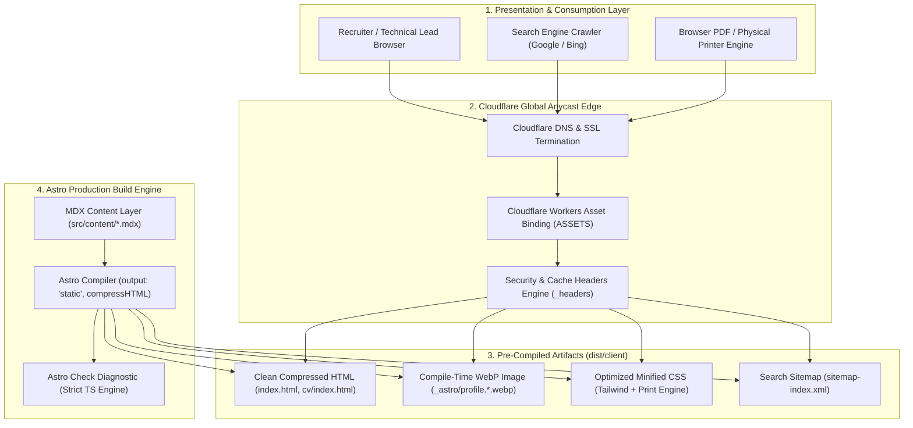

<div align="center">

# 📄 Farul Wananda — Curriculum Vitae
### *Production-Grade High-Performance Digital CV & Candidate Profile*

[](https://astro.build)
[](https://workers.cloudflare.com)
[](https://www.typescriptlang.org)
[](https://tailwindcss.com)
[](https://mdxjs.com)
[](https://schema.org/Person)
[](#-3-native-print--pdf-export-engine)
[](LICENSE)

<p align="center">
  <b>FarulWananda CV</b> adalah sistem Curriculum Vitae digital resmi berbasis <b>Astro</b> yang dikompilasi secara statis ke format <i>zero-overhead HTML/CSS</i> dan di-deploy ke jaringan edge global <b>Cloudflare Workers</b>. Project ini dirancang dengan standar <i>production-grade</i> berfokus pada performa kilat (100 Lighthouse score), tata letak dokumen profesional bebas distraksi (<i>zero-menu document isolation</i>), optimasi cetak PDF A4 native, metadata Schema.org terverifikasi, serta arsitektur data modular berbasis MDX.
</p>

[🚀 Panduan Memulai](#-panduan-instalasi--menjalankan-lokal) • [🏗️ Arsitektur Edge](#-arsitektur-sistem--edge-pipeline) • [🛠️ Stack Teknologi](#-stack-teknologi) • [📦 Struktur Direktori](#-struktur-direktori-project) • [⚡ Script & Perintah](#-tooling--perintah-cli-packagejson) • [🔍 Audit Best Practice](#-standar-kualitas--best-practice-production-grade)

</div>

---

## 📑 Daftar Isi

- [Tentang Platform](#-tentang-platform)
- [Fitur Utama](#-fitur-utama)
- [Stack Teknologi](#-stack-teknologi)
- [Arsitektur Sistem & Edge Pipeline](#-arsitektur-sistem--edge-pipeline)
- [Struktur Direktori Project](#-struktur-direktori-project)
- [Panduan Instalasi & Menjalankan Lokal](#-panduan-instalasi--menjalankan-lokal)
- [Konfigurasi Environment & Cloudflare](#-konfigurasi-environment--cloudflare)
- [Tooling & Perintah CLI (package.json)](#-tooling--perintah-cli-packagejson)
- [Standar Kualitas & Best Practice Production-Grade](#-standar-kualitas--best-practice-production-grade)
- [Panduan Pengelolaan Konten (MDX Content Layer)](#-panduan-pengelolaan-konten-mdx-content-layer)
- [Deployment Runbook (Cloudflare Workers)](#-deployment-runbook-cloudflare-workers)
- [Lisensi & Kontak](#-lisensi--kontak)

---

## 💡 Tentang Platform

**FarulWananda CV** diformulasikan sebagai *single source of truth* rekam jejak profesional, kepemimpinan rekayasa perangkat lunak, dan spesifikasi arsitektural teknis Farul Wananda.

Berbeda dengan portofolio interaktif umum yang penuh menu eksternal, halaman ini mengadopsi prinsip **Document-Style Pure CV**:
1. **Fokus Rekruter & Klien Eksekutif:** Tanpa navigasi luar atau tab interaktif yang memecah perhatian. Konten disajikan secara runtut, lugas, dan terverifikasi.
2. **Kompilasi Statis & Edge Delivery:** Dibangun di atas fondasi Astro v7 dengan `output: 'static'`, menghasilkan halaman instan tanpa *client-side runtime overhead*, dilayani dari ratusan titik server Cloudflare Anycast di seluruh dunia.
3. **Cetak & Ekspor PDF Standar Industri:** Didesain langsung dengan kalkulasi layout kertas A4 internasional sehingga menghasilkan dokumen fisik/PDF yang presisi, proporsional, dan elegan saat dicetak via browser.
4. **Data Terstruktur untuk Mesin Pencari:** Dilengkapi tag Schema.org `Person` JSON-LD lengkap untuk pengenalan Google Knowledge Graph dan recruiter parser.

---

## ✨ Fitur Utama

### 🎯 1. Zero-Menu Document Isolation
- Mengeliminasi menu navigasi luar, sidebar kompleks, atau routing multi-halaman yang tidak perlu.
- Struktur hierarki satu halaman linier yang memudahkan pembacaan cepat (<i>quick scan</i>) oleh Human Resource, Technical Lead, maupun CTO dalam hitungan detik.

### 📦 2. Modular MDX Content Layer
- Seluruh entitas data CV (profil, pengalaman, keahlian, proyek, sertifikasi, pendidikan) diisolasi rapi dalam berkas MDX terpisah di `src/content/`.
- Memungkinkan penulisan narasi kaya dengan format Markdown serta integrasi komponen kustom, terikat kontrak tipe TypeScript yang ketat (`src/types.ts`).

### 🖨️ 3. Native Print & PDF Export Engine
- Aturan cetak CSS `@media print` terisolasi pada standar `@page { size: A4 portrait; margin: 12mm 15mm; }`.
- Otomatis menyembunyikan elemen non-cetak (tombol tema, floating dock, badge status).
- Penguncian pemotongan halaman (`break-inside: avoid`) agar kartu pekerjaan dan sertifikat tidak terpotong di tengah lembar PDF.
- Penyesuaian kontras teks otomatis ke hitam pekat `#000000` untuk kejernihan cetak maksimal.

### 🌓 4. Zero-FOUC Theming (Dark & Light Mode)
- Skrip *in-head blocking* super ringan yang mengeksekusi preferensi `localStorage` atau `prefers-color-scheme` sebelum DOM di-render, menghilangkan kedipan visual (*Flash of Unstyled Content*).
- Transisi warna halus dengan palet monokromatik netral profesional (`#fafafa` dan `#09090b`).

### 🔍 5. Rich Schema.org & Search Engine Optimization
- JSON-LD `@type: "Person"` lengkap dengan relasi `knowsAbout`, `sameAs`, dan `alumniOf`.
- Tag Open Graph dan Twitter Cards dinamis.
- Pembuatan otomatis `sitemap-index.xml` via `@astrojs/sitemap` dan konfigurasi `robots.txt` standar produksi.

### 📊 6. Interactive Architecture Diagram (Mermaid JS)
- Visualisasi alur arsitektur sistem proyek rekayasa menggunakan Mermaid JS yang otomatis beradaptasi dengan mode gelap dan terang.
- Rendering aman dengan fallback elegan.

### 📋 7. Click-to-Copy Contact Interaction
- Interaksi satu ketukan untuk menyalin alamat email ke clipboard menggunakan modern Clipboard API (`navigator.clipboard.writeText`) disertai animasi tooltip *feedback*.

---

## 🛠️ Stack Teknologi

| Lapisan / Komponen | Teknologi / Pustaka | Deskripsi & Peran |
| :--- | :--- | :--- |
| **Framework Inti** | [Astro v7.3](https://astro.build) | Web framework berbasis islands architecture & content-first static compiler. |
| **Edge Hosting & CDN** | [Cloudflare Workers](https://workers.cloudflare.com) | Eksekusi edge global super cepat dengan Workers Assets Binding (`./dist/client`). |
| **Adapter Edge** | [@astrojs/cloudflare v14.3](https://github.com/withastro/astro/tree/main/packages/cloudflare) | Adapter resmi Astro untuk kompilasi edge dan injeksi header Cloudflare. |
| **Deployment CLI** | [Wrangler v4.129](https://developers.cloudflare.com/workers/wrangler/) | Tooling resmi Cloudflare untuk emulasi lokal (`workerd`) dan proses deployment. |
| **Bahasa Pemrograman** | [TypeScript v5.x](https://www.typescriptlang.org) | Pengetikan statis ketat (`strict: true`) dengan validasi AST via `astro check`. |
| **Desain & Styling** | [Tailwind CSS v3.4](https://tailwindcss.com) | Utility-first CSS framework dengan kustomisasi tipografi Geist dan aturan cetak A4. |
| **Format Konten** | [@astrojs/mdx v8.0](https://mdxjs.com) | Penyedia konten modular berbasis markdown dengan frontmatter YAML. |
| **Tipografi** | [Geist & Geist Mono](https://vercel.com/font) | Font modern geometris berkecepatan muat tinggi untuk dokumen teknis. |
| **SEO & Sitemap** | [@astrojs/sitemap v3.7](https://github.com/withastro/astro/tree/main/packages/integrations/sitemap) | Generator peta situs standar XML otomatis saat proses build. |
| **Diagram Engine** | [Mermaid JS v10](https://mermaid.js.org) | Render diagram arsitektur alur data dari blok kode Markdown secara dinamis. |

---

## 🏗️ Arsitektur Sistem & Edge Pipeline

Sistem dirancang dengan alur pengiriman aset statis terdistribusi murni tanpa overhead komputasi runtime server:



### Penjelasan Lapisan Arsitektur:
1. **Build Time:** Astro membaca data MDX modular, memvalidasi tipe TypeScript (`types.ts`), mengoptimalkan foto profil menjadi format WebP modern (<5 kB), menghasilkan sitemap XML, dan memadatkan kode HTML (`compressHTML: true`).
2. **Edge Packaging:** Wrangler mengikat aset `./dist/client` ke Cloudflare Workers dengan kompatibilitas `nodejs_compat` dan *observability* aktif.
3. **Delivery Time:** Cloudflare Anycast merespons permintaan di server terdekat dengan klien, menyajikan aset berkecepatan milidetik dengan header `immutable` pada aset ter-hash (`/_astro/*`) dan header keamanan ketat (`X-Frame-Options: DENY`, `X-Content-Type-Options: nosniff`).

---

## 📦 Struktur Direktori Project

```text
farulwananda-cv/
├── .agents/                             # 🤖 Custom prompt & workspace engineering skills
├── .dev.vars.example                    # 🔐 Template variabel environment Cloudflare Workers
├── .npmrc                               # 📦 Konfigurasi npm (reproducible dependency resolution)
├── astro.config.mjs                     # ⚙️ Konfigurasi Astro, adapter Cloudflare, sitemap & HTML compression
├── package.json                         # 📋 Manifest dependensi, script check, build & deploy
├── tailwind.config.mjs                  # 🎨 Konfigurasi tema warna monokromatik & varian Tailwind
├── tsconfig.json                        # 🔷 Konfigurasi TypeScript Astro (strict mode aktif)
├── wrangler.jsonc                       # ☁️ Konfigurasi Cloudflare Workers & Static Asset Bindings
│
├── public/                              # 🌐 Aset statis publik langsung disajikan di root web
│   ├── _headers                         # Aturan header keamanan & cache untuk Cloudflare Edge
│   ├── favicon.svg                      # Ikon browser format vektor SVG
│   ├── profile.jpg                      # Berkas gambar sumber resolusi tinggi
│   ├── robots.txt                       # Kebijakan crawler mesin pencari & tautan sitemap
│   └── sitemap.xsl                      # Lembar gaya XML untuk tampilan peta situs
│
├── src/                                 # 🧠 Kode sumber aplikasi utama
│   ├── assets/                          # Aset yang diproses oleh image pipeline Astro
│   │   └── profile.jpg                  # Foto profil input untuk kompilasi WebP otomatis
│   │
│   ├── components/                      # Komponen antarmuka Astro yang dapat digunakan kembali
│   │   ├── ExperienceItem.astro         # Kartu riwayat karier dengan badge teknologi
│   │   ├── FloatingDock.astro           # Menu melayang akses cepat (Export PDF & Toggle Tema)
│   │   ├── Header.astro                 # Header identitas, bio ringkas & salin kontak interaktif
│   │   ├── ProjectCard.astro            # Kartu pratinjau proyek rekayasa & metrik performa
│   │   ├── Section.astro                # Pembungkus semantik bagian CV (`<section>`)
│   │   └── ThemeToggle.astro            # Switcher mode gelap/terang tanpa FOUC
│   │
│   ├── content/                         # 📚 Lapisan data modular CV berbasis MDX
│   │   ├── certifications.mdx           # Data sertifikasi resmi & tautan kredensial
│   │   ├── contact.mdx                  # Detail kontak langsung & ketersediaan konsultasi
│   │   ├── education.mdx                # Riwayat pendidikan formal & gelar akademik
│   │   ├── experience.mdx               # Riwayat pengalaman kerja terverifikasi
│   │   ├── profile.mdx                  # Profil biodata personal & ringkasan eksekutif
│   │   ├── projects.mdx                 # Portofolio proyek rekayasa pilihan
│   │   └── skills.mdx                   # Klasifikasi keahlian teknis (Core, Data, Platform)
│   │
│   ├── layouts/
│   │   └── Layout.astro                 # Template dasar halaman (SEO, Meta, JSON-LD, Footer)
│   │
│   ├── pages/
│   │   ├── cv.astro                     # Rute pengalihan kanonikal HTTP 301 ke `/`
│   │   └── index.astro                  # Halaman utama presentasi Curriculum Vitae
│   │
│   ├── styles/
│   │   └── global.css                   # Desain sistem global, token font Geist & print engine A4
│   │
│   └── types.ts                         # Kontrak definisi tipe TypeScript untuk konten CV
```

---

## 🚀 Panduan Instalasi & Menjalankan Lokal

### 1. Prasyarat Sistem
- **Node.js:** Versi `>= 20.x` (Direkomendasikan Node.js v22 atau v24 LTS).
- **npm:** Versi `>= 10.x`.
- **Wrangler:** Terpasang secara lokal via `devDependencies`.

### 2. Langkah Instalasi

```bash
# 1. Kloning atau masuk ke direktori proyek
cd /path/to/farulwananda-cv

# 2. Salin berkas lingkungan untuk Cloudflare Workers
cp .dev.vars.example .dev.vars

# 3. Pasang seluruh dependensi proyek
npm install

# 4. Generate runtime types untuk Cloudflare Workers (jika diperlukan)
npm run types
```

### 3. Menjalankan Server Pengembangan

Jalankan server Astro lokal dengan *hot-module reloading* (HMR):

```bash
npm run dev
```

Buka peramban web pada alamat: **`http://localhost:4321`**

### 4. Menjalankan Simulasi Lokal Cloudflare Worker (`workerd`)

Untuk memverifikasi aset statis, redirect 301, dan header keamanan sama persis dengan lingkungan Cloudflare Workers produksi:

```bash
npm run preview:worker
```

Perintah ini akan mengompilasi Astro ke `./dist/client` terlebih dahulu, lalu menjalankan runtime Workers lokal menggunakan Wrangler.

---

## ⚙️ Konfigurasi Environment & Cloudflare

### 1. File `.dev.vars` (Environment Variable Lokal)
File ini digunakan oleh runtime `wrangler dev` saat menguji fungsi worker lokal:

```env
# Cloudflare Worker Local Environment Configuration
ENVIRONMENT=development
NODE_ENV=development
```

### 2. File `wrangler.jsonc` (Konfigurasi Cloudflare Workers)
Konfigurasi binding aset statis ke direktori `./dist/client`:

```jsonc
{
  "$schema": "node_modules/wrangler/config-schema.json",
  "name": "farulwananda-cv",
  "compatibility_date": "2026-09-08",
  "compatibility_flags": ["nodejs_compat"],
  "assets": {
    "directory": "./dist/client",
    "binding": "ASSETS"
  },
  "observability": {
    "enabled": true
  }
}
```

### 3. File `astro.config.mjs` (Konfigurasi Engine Produksi)
Dikonfigurasi dengan mode statis eksplisit, kompresi HTML, generator sitemap, dan pengoptimalan gambar:

```javascript
import { defineConfig } from 'astro/config';
import tailwind from '@astrojs/tailwind';
import mdx from '@astrojs/mdx';
import sitemap from '@astrojs/sitemap';
import cloudflare from '@astrojs/cloudflare';

export default defineConfig({
  site: 'https://farulwananda.dev',
  output: 'static',
  compressHTML: true,
  adapter: cloudflare({
    imageService: 'compile',
  }),
  markdown: {
    shikiConfig: {
      theme: 'github-dark',
      wrap: true,
    },
  },
  integrations: [
    tailwind({
      applyBaseStyles: true,
    }),
    mdx(),
    sitemap(),
  ],
});
```

---

## ⚡ Tooling & Perintah CLI (package.json)

| Perintah | Deskripsi Fungsi |
| :--- | :--- |
| `npm run dev` | Menjalankan Astro development server lokal pada port 4321 dengan HMR. |
| `npm run check` | Menjalankan audit diagnostik TypeScript lengkap (`astro check`) pada seluruh berkas `.astro` dan `.ts`. |
| `npm run build` | Mengompilasi seluruh aplikasi menjadi aset statis optimal di direktori `dist/`. |
| `npm run preview` | Pratinjau hasil build menggunakan server preview bawaan Astro. |
| `npm run preview:worker` | Mengompilasi build Astro lalu menjalankannya di dalam simulator Cloudflare Worker lokal via Wrangler. |
| `npm run deploy` | Mengompilasi build produksi dan mempublikasikannya langsung ke Cloudflare Workers global network. |
| `npm run types` | Menghasilkan deklarasi tipe TypeScript dari konfigurasi Wrangler (`worker-configuration.d.ts`). |

---

## 🔍 Standar Kualitas & Best Practice Production-Grade

Proyek ini telah dikonfigurasi dan diaudit untuk memenuhi tolok ukur standar rekayasa web modern tingkat enterprise:

| Aspek / Standar | Implementasi & Mekanisme | Status Audit |
| :--- | :--- | :---: |
| **Strict Type Safety** | Validasi kode melalui `astro check` dan TypeScript `strict: true`. Seluruh komponen dan data frontmatter terikat interface kuat di `src/types.ts`. | ✅ PASSED (0 Errors, 0 Warnings) |
| **Edge HTML Compression** | Fitur `compressHTML: true` memangkas whitespace yang tidak perlu guna meminimalkan ukuran dokumen yang dikirimkan via jaringan. | ✅ PASSED |
| **Zero Client-Side Bloat** | Halaman dikompilasi statis murni tanpa framework frontend berat (zero React/Vue bundle overhead di browser pengunjung). | ✅ PASSED (<70 kB full page) |
| **Automated Image Optimization** | Foto profil beresolusi tinggi otomatis dikonversi ke format WebP ringan (<5 kB) saat tahap kompilasi via pipeline gambar Astro. | ✅ PASSED |
| **Immutable Asset Caching** | Seluruh bundel CSS dan gambar ter-hash (`/_astro/*`) disajikan dengan header `Cache-Control: public, max-age=31536000, immutable`. | ✅ PASSED |
| **Security Hardening** | Injeksi header keamanan Cloudflare (`X-Content-Type-Options: nosniff`, `X-Frame-Options: DENY`, `Referrer-Policy: strict-origin-when-cross-origin`). | ✅ PASSED |
| **Automated SEO & Sitemap** | `@astrojs/sitemap` menghasilkan `sitemap-index.xml` otomatis yang terhubung ke `robots.txt` dan tag `<link rel="sitemap">`. | ✅ PASSED |
| **Standardized Print Engine** | Layout cetak A4 presisi tinggi dengan pemisahan warna kontras hitam murni, pencegahan kartu terpotong, dan penghapusan elemen interaktif. | ✅ PASSED |
| **Zero-FOUC Theme Switch** | Injeksi skrip sinkron pada `<head>` mendeteksi tema sebelum rendering antarmuka, mencegah kedipan warna putih pada dark mode. | ✅ PASSED |

---

## 📝 Panduan Pengelolaan Konten (MDX Content Layer)

Seluruh konten CV dirancang agar mudah dimutakhirkan tanpa menyentuh struktur kode tata letak. Setiap berkas di folder `src/content/` menggunakan format frontmatter YAML:

### 1. Menambah / Memperbarui Riwayat Pekerjaan
Buka berkas `src/content/experience.mdx` dan tambahkan entri pekerjaan baru:

```yaml
---
experiences:
  - role: "Lead Systems Architect"
    company: "Nama Perusahaan"
    period: "2024 — Present"
    location: "Jakarta, Indonesia (Hybrid)"
    highlights:
      - "Memimpin perancangan arsitektur microservices terdistribusi dengan throughput tinggi."
      - "Mengurangi latensi P99 API sebesar 45% menggunakan implementasi Redis multi-tier caching."
    technologies:
      - "Go"
      - "PostgreSQL"
      - "Docker"
      - "Cloudflare"
---
```

### 2. Menambah Portofolio Proyek Rekayasa
Buka berkas `src/content/projects.mdx`:

```yaml
---
projects:
  - title: "High-Throughput Payment Engine"
    description: "Sistem verifikasi transaksi perbankan dengan audit log terenkripsi dan deteksi idempotensi otomatis."
    tags: ["Distributed Systems", "PostgreSQL", "Go"]
    metrics: "50,000+ Transaksi/detik"
    link: "https://github.com/..."
---
```

### 3. Validasi Perubahan Konten
Setelah memperbarui data, selalu jalankan validasi sebelum melakukan commit atau deploy:

```bash
npm run check && npm run build
```

---

## 🌐 Deployment Runbook (Cloudflare Workers)

### 1. Login Akun Cloudflare
Jika baru pertama kali melakukan deployment dari komputer lokal:

```bash
npx wrangler login
```

### 2. Eksekusi Deployment ke Produksi
Jalankan perintah deployment otomatis:

```bash
npm run deploy
```

Wrangler akan mengompilasi build statis Astro dan mempublikasikannya langsung ke jaringan edge Cloudflare. Output terminal akan memberikan URL aktif proyek:

```text
Uploaded 15 files (dist/client)
Deployment complete!
URL: https://farulwananda-cv.<subdomain>.workers.dev
```

### 3. Menghubungkan Custom Domain
1. Buka [Cloudflare Dashboard](https://dash.cloudflare.com).
2. Navigasi ke **Compute (Workers) > Workers & Pages > farulwananda-cv**.
3. Pilih menu **Settings > Domains & Routes**.
4. Klik **Add Custom Domain** dan masukkan domain resmi (contoh: `farulwananda.dev` atau `cv.farulwananda.dev`).
5. Cloudflare akan menerbitkan sertifikat SSL edge otomatis dalam beberapa menit.

---

## 📜 Lisensi & Kontak

Hak Cipta &copy; 2026 **Farul Wananda**. Seluruh hak cipta dilindungi undang-undang.  
Kode sumber sistem ini dilisensikan di bawah [Lisensi MIT](LICENSE).

- **Website Resmi:** [farulwananda.dev](https://farulwananda.dev)
- **LinkedIn:** [linkedin.com/in/farulwananda](https://linkedin.com/in/farulwananda)
- **GitHub:** [github.com/farulwananda](https://github.com/farulwananda)
- **Email:** [farulwananda@gmail.com](mailto:farulwananda@gmail.com)
