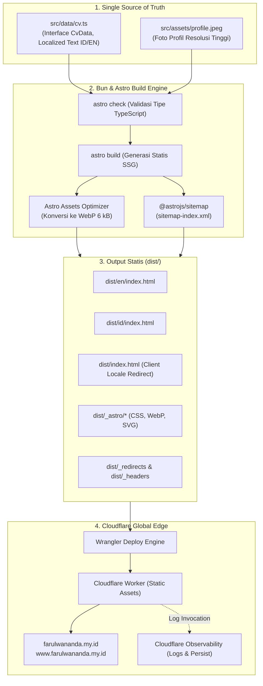

<div align="center">

# 📄 Farul Wananda — Personal CV & Engineering Profile
### *High-Performance, Print-Friendly & Bilingual Curriculum Vitae Platform*

[](https://astro.build)
[](https://bun.sh)
[](https://www.typescriptlang.org)
[](https://workers.cloudflare.com)
[](https://developer.mozilla.org/en-US/docs/Web/CSS)
[](https://phosphoricons.com)
[](LICENSE)

<p align="center">
  <b>Farul Wananda CV</b> adalah proyek web personal berbasis <b>Astro Static Site Generation (SSG)</b> yang dirancang khusus sebagai representasi profesional, rekam jejak rekayasa perangkat lunak (<i>software engineering</i>), serta resume standar cetak A4 eksekutif. Mengedepankan efisiensi eksekusi tinggi tanpa framework JavaScript berat di sisi klien, navigasi multibahasa mulus dengan View Transitions API, serta penyajian aset statis secepat kilat di jaringan edge global <b>Cloudflare Workers</b>.
</p>

[🌐 Kunjungi Website (farulwananda.my.id)](https://farulwananda.my.id) • [🚀 Panduan Menjalankan Lokal](#-panduan-instalasi--menjalankan-lokal) • [🛠️ Stack Teknologi](#-stack-teknologi) • [✨ Fitur Utama](#-fitur-utama) • [🏗️ Arsitektur Alur Data](#-arsitektur--alur-data) • [📦 Struktur Direktori](#-struktur-direktori-project)

</div>

---

## 📑 Daftar Isi

- [Tentang Proyek](#-tentang-proyek)
- [Stack Teknologi](#-stack-teknologi)
- [Fitur Utama & Keunggulan](#-fitur-utama--keunggulan)
- [Arsitektur & Alur Data](#-arsitektur--alur-data)
- [Struktur Direktori Project](#-struktur-direktori-project)
- [Panduan Instalasi & Menjalankan Lokal](#-panduan-instalasi--menjalankan-lokal)
- [Struktur Data & Pembaruan Konten](#-struktur-data--pembaruan-konten)
- [Deployment Cloudflare Workers](#-deployment-cloudflare-workers)
- [Observability & Monitoring](#-observability--monitoring)
- [Lisensi](#-lisensi)

---

## 💡 Tentang Proyek

Proyek ini dibangun sendiri oleh **Farul Wananda** (Software Engineer & Backend Engineer) untuk menghadirkan resume digital berstandar industri dengan pendekatan *content-first engineering*:

- **Zero-Bloat Runtime:** Menghindari beban *framework client-side* berat untuk dokumen statis. Halaman dirender penuh saat waktu build (*build-time*) menghasilkan HTML murni dan CSS teroptimasi.
- **Rasio Baca & Cetak Presisi:** Menggunakan tata letak satu kolom (*single-column layout*) selebar `700px` yang selaras dengan proporsi margin dokumen kertas A4 (180mm).
- **Akses Global Sub-Detik:** Dideploy langsung ke 300+ lokasi edge server Cloudflare menggunakan fitur **Workers Static Assets**, meminimalkan latensi pembacaan di seluruh dunia.
- **Bilingual Terintegrasi:** Mendukung dua bahasa resmi (**Indonesia** di `/id/` dan **English** di `/en/`) dengan pendeteksi bahasa otomatis di root `/`.

---

## 🛠️ Stack Teknologi

| Komponen / Lapisan | Teknologi / Pustaka | Deskripsi & Peran |
| :--- | :--- | :--- |
| **Runtime & Tooling** | [Bun v1.4.2+](https://bun.sh) | All-in-one JavaScript/TypeScript runtime tercepat, package manager (`bun.lock`), dan runner perintah. |
| **Static Framework** | [Astro v7.3+](https://astro.build) | Web framework modern berorientasi konten untuk menghasilkan halaman statis murni dengan skor Lighthouse 100. |
| **Bahasa Pemrograman** | [TypeScript v5.9+](https://www.typescriptlang.org) | Pengetikan data yang ketat (*strict typing*) melalui interface `CvData` di `src/data/cv.ts`. |
| **Styling Engine** | Modern Vanilla CSS | Desain kustom elegan berbasis CSS Variables (`--paper`, `--ink`, `--line`, `--accent`), CSS Grid, dan Flexbox tanpa dependensi eksternal. |
| **Tipografi** | [Space Grotesk Variable](https://fontsource.org/fonts/space-grotesk) | Tipografi tajam dan berkarakter untuk judul, kode, serta elemen identitas visual. |
| **Iconography** | [Astro Icon](https://github.com/natemoo-re/astro-icon) + [Phosphor Icons](https://phosphoricons.com) | Ikon SVG teroptimasi tanpa JavaScript eksternal dari koleksi `@iconify-json/ph`. |
| **Transisi Halaman** | [Astro ClientRouter (View Transitions)](https://docs.astro.build/en/guides/view-transitions/) | Animasi pergantian bahasa dan tema yang mulus dengan hardware acceleration tanpa reload penuh. |
| **Hosting & Edge Delivery** | [Cloudflare Workers (Static Assets)](https://developers.cloudflare.com/workers/) | Penyajian berkas statis dari edge network Cloudflare dengan TLS/SSL otomatis dan HTTP/2 / HTTP/3. |
| **Observability** | Cloudflare Workers Logs | Logging invocations, analisis request, dan pelacakan metrik trafik secara real-time di Cloudflare Dashboard. |
| **SEO & Validasi** | `@astrojs/sitemap`, Custom Assert Script | Generator peta situs otomatis `sitemap-index.xml`, canonical URLs, meta tags lengkap, dan pre-deploy gatekeeper. |

---

## ✨ Fitur Utama & Keunggulan

### 🌐 1. Multibahasa Terkalibrasi (Bilingual ID / EN)
- **Struktur URL Bersih:** Halaman bahasa Indonesia di `/id/` dan bahasa Inggris di `/en/`.
- **Sliding Indicator Switcher:** Komponen pemilihan bahasa bergaya *segmented control* dengan animasi geser fisik yang presisi tanpa kedip.
- **Deteksi Otomatis:** Root URL `/` otomatis mendeteksi preferensi peramban pengguna (*browser locale*) dan mengarahkan ke bahasa yang sesuai.

### 🌗 2. Tema Terang & Gelap (Light / Dark Mode)
- **Palet Warna Kurasi:** Warna gelap berbasis slate gelap hangat (`#191b19`) dengan aksen terakota (`#ef9b78`) yang nyaman di mata untuk sesi membaca lama.
- **Persistensi Lokal:** Mengingat preferensi tema pengguna melalui `localStorage` dan mendeteksi pengaturan sistem operasi (`prefers-color-scheme`).

### 🖨️ 3. Print-Ready Engine (Format A4 Resmi)
- **Tombol Cetak Cepat:** Tombol print khusus di toolbar yang langsung memicu dialog cetak peramban.
- **Print CSS Terisolasi:** Saat dicetak atau disimpan ke PDF, toolbar aksi dan navigasi disembunyikan otomatis, warna dioptimalkan menjadi kontras tinggi hitam-putih ramah tinta, dan page break dijaga agar tidak memotong entri pekerjaan.

### ⚡ 4. Single-Column Responsive Layout
- **Lebar Kontainer 700px:** Menghilangkan jurang kosong antara teks dan tanggal di desktop, serta responsif penuh di perangkat seluler dengan margin adaptif.
- **Tipografi Selaras:** Subjudul dan meta entri dipisahkan dengan separator titik tengah (` · `) yang konsisten di semua bagian (Pengalaman, Proyek, Sertifikasi, dan Pendidikan).

---

## 🏗️ Arsitektur & Alur Data

Sistem menerapkan siklus hidup satu sumber kebenaran (*single source of truth*) yang ketat:



---

## 📦 Struktur Direktori Project

```
farulwananda-cv/
├── .github/
│   └── workflows/
│       └── ci.yml                     # 🤖 GitHub Actions CI (Validasi TypeCheck & Build)
├── public/                            # 🌐 Berkas statis publik langsung
│   ├── _headers                       # Konfigurasi Security & Cache Headers Cloudflare
│   ├── _redirects                     # Aturan redirect edge Cloudflare
│   └── robots.txt                     # Kebijakan perayapan search engine
├── scripts/
│   └── assert-publishable.mjs         # 🛡️ Skrip validasi keamanan sebelum deploy
├── src/
│   ├── assets/
│   │   └── profile.jpeg               # 📸 Foto profil resmi Farul Wananda
│   ├── components/
│   │   └── CvPage.astro               # 🧱 Komponen utama CV, Toolbar, Header, dan Sections
│   ├── data/
│   │   └── cv.ts                      # 🧠 Single source of truth seluruh isi konten CV
│   ├── layouts/
│   │   └── Layout.astro               # 📐 Shell HTML, Meta SEO, Font, dan View Transitions
│   ├── pages/
│   │   ├── en/
│   │   │   └── index.astro            # 🇺🇸 Halaman CV versi bahasa Inggris
│   │   ├── id/
│   │   │   └── index.astro            # 🇮🇩 Halaman CV versi bahasa Indonesia
│   │   └── index.astro                # 🔀 Root redirector berdasarkan preferensi peramban
│   └── styles/
│       └── global.css                 # 🎨 Design system, CSS tokens, layout 700px, & print CSS
├── .gitignore                         # Berkas yang dikecualikan dari Git
├── astro.config.mjs                   # Konfigurasi build Astro, Sitemap, dan Icon
├── bun.lock                           # Kunci dependensi reproduksibel Bun
├── LICENSE                            # Lisensi sumber terbuka MIT
├── package.json                       # Konfigurasi dependensi dan skrip proyek
├── tsconfig.json                      # Konfigurasi compiler TypeScript
└── wrangler.jsonc                     # ☁️ Konfigurasi Cloudflare Workers & Observability
```

---

## 🚀 Panduan Instalasi & Menjalankan Lokal

### 1. Prasyarat Sistem
- **Bun:** Versi `>= 1.4.2` ([Instal Bun](https://bun.sh))
- Peramban web modern (Google Chrome, Brave, Safari, atau Firefox)

### 2. Langkah Menjalankan

```bash
# 1. Clone repositori
git clone https://github.com/farulwananda/farulwananda-cv.git
cd farulwananda-cv

# 2. Pasang dependensi secara tepat sesuai bun.lock
bun install --frozen-lockfile

# 3. Jalankan development server lokal
bun run dev
```

Buka peramban pada alamat:
- **Indonesia:** [`http://localhost:4321/id/`](http://localhost:4321/id/)
- **English:** [`http://localhost:4321/en/`](http://localhost:4321/en/)

### 3. Skrip Perintah yang Tersedia

| Perintah | Deskripsi |
| :--- | :--- |
| `bun run dev` | Menjalankan server lokal pengembangan di port 4321 dengan hot-reload. |
| `bun run check` | Memeriksa integritas tipe data TypeScript dan template Astro (`astro check`). |
| `bun run build` | Menjalankan type-check dan mem-build output statis produksi ke folder `dist/`. |
| `bun run preview` | Menjalankan preview lokal dari hasil build statis di folder `dist/`. |
| `bun run deploy:dry-run` | Melakukan uji coba kompilasi dan simulasi upload aset ke Cloudflare tanpa mempublikasikannya. |
| `bun run deploy` | Memeriksa tipe data, build, validasi assert, dan mempublikasikan ke Cloudflare Workers. |

---

## 📝 Struktur Data & Pembaruan Konten

Seluruh data konten CV tersimpan terpusat di satu berkas: [`src/data/cv.ts`](src/data/cv.ts).

Setiap entri teks multibahasa menggunakan tipe `LocalizedText`:
```typescript
interface LocalizedText {
  id: string; // Teks bahasa Indonesia
  en: string; // Teks bahasa Inggris
}
```

### Mengubah Data Pribadi / Riwayat:
1. Buka [**`src/data/cv.ts`**](src/data/cv.ts).
2. Perbarui bagian yang diinginkan (`summary`, `skills`, `experience`, `projects`, `certifications`, atau `education`).
3. Pastikan kedua bahasa (`id` dan `en`) diperbarui secara selaras.
4. Simpan berkas, lalu jalankan `bun run check` untuk memverifikasi tidak ada kesalahan tipe data.

---

## ☁️ Deployment Cloudflare Workers

Aplikasi ini berjalan di atas infrastruktur **Cloudflare Workers** dengan model **Static Assets** murni:

1. **Konfigurasi `wrangler.jsonc`:**
   ```jsonc
   {
     "$schema": "./node_modules/wrangler/config-schema.json",
     "name": "farulwananda-cv",
     "compatibility_date": "2026-09-24",
     "assets": {
       "directory": "./dist",
       "html_handling": "auto-trailing-slash",
       "not_found_handling": "none"
     },
     "observability": {
       "enabled": true,
       "logs": {
         "enabled": true,
         "invocation_logs": true,
         "persist": true
       }
     }
   }
   ```
2. **Domain Kustom Terhubung:**
   - `farulwananda.my.id` (Apex Domain)
   - `www.farulwananda.my.id` (Subdomain)
3. **CI/CD Otomatis:**
   Setiap commit yang di-push ke branch `main` di GitHub akan memicu build otomatis di Cloudflare Workers Builds dan me-redeploy perubahan dalam hitungan detik.

---

## 📊 Observability & Monitoring

Fitur **Cloudflare Workers Observability** diaktifkan secara bawaan:
- **Request Invocations:** Memantau jumlah kunjungan, status HTTP, durasi eksekusi, dan konsumsi bandwidth.
- **Persistent Logging:** Log dicatat dan dapat di-query langsung melalui Cloudflare Dashboard pada tab **Workers & Pages > farulwananda-cv > Observability > Logs**.

---

## 📜 Lisensi

Proyek ini dilisensikan di bawah lisensi terbuka [**MIT License**](LICENSE).

Hak Cipta &copy; 2026 **Farul Wananda**. Bebas digunakan sebagai referensi atau fondasi pembuatan CV digital personal Anda dengan mencantumkan atribusi.
